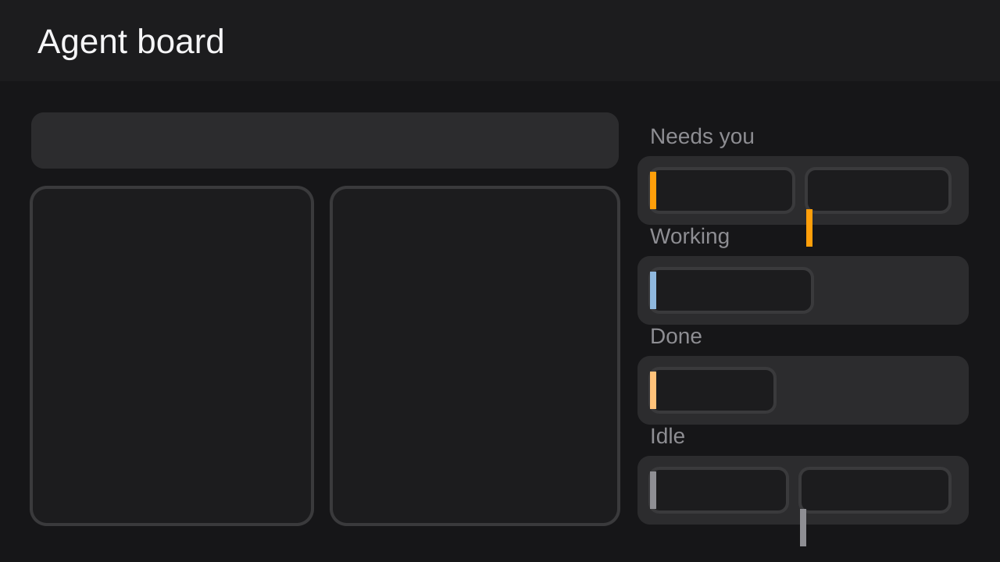

# Herdr side board

A Herdr layout for watching agents while you work in the terminal.

Terminals fill the left. Needs you, Working, Done, and Idle stack down the right and share that rail. Each session is a small badge. A note sits on the next line under the label, only as wide as the note.

Drag the gap between two lanes to give one more room without moving the others. Double-click a gap to reset all four lanes to equal heights. Herdr saves your lane sizes.



## Install

```sh
git clone git@github.com:timjonez/herdr-side-board.git
./herdr-side-board/install.sh
```

That copies `layouts/board-side.json` and the four mods into `~/.config/herdr-app`, merges Ctrl+Shift+M to open the note for the shown session, and switches a running Herdr to this layout. Replaced files are backed up under `~/.config/herdr-app/.backup/`. Ctrl+Shift+L cycles away from it. Deleting the copied files removes it.

Needs Herdr (`herdr-app`). History also needs `python3` on each machine whose past sessions you want to search.

## What it includes

- `layouts/board-side.json` — the window.
- `mods/board-side` — header, tab strip, pane headers, and the lanes.
- `mods/board-side-new` — pick a machine, then start a terminal or an installed agent.
- `mods/board-side-note` — the sticky note editor. Presets: waiting on stakeholder, waiting on PR approval, blocked on review, parked.
- `mods/board-side-history` — search past Claude Code and OpenCode sessions and reopen one where it ran.

History runs `python3` on each connected machine and reads that machine's Claude and OpenCode session files. It does not send them anywhere. The other mods do not run programs or fetch the network.

`RECIPE.md` is the brief for rebuilding this layout from scratch.
