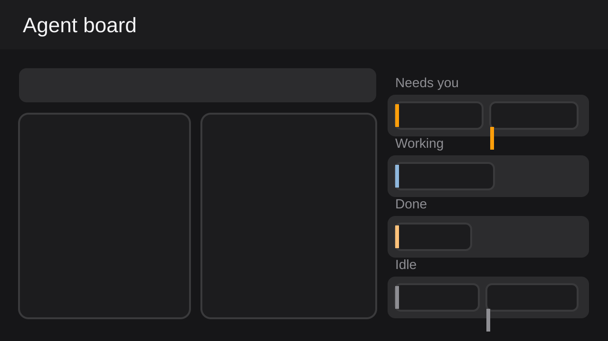

# Side board

Terminals fill the left side of the window. On the right, Needs you, Working, Done, and Idle stack from top to bottom and share the full height of that rail. Each session is a small badge. When a session has a note, the note sits on the next line under the label and is only as wide as the note.

## What you see

The window has no system title bar. The root is a column on `canvas`, Geist at 13px, terminal padding 12 by 10.

The header is a 100px window-drag block. It shows "Agent board", a connection dot and agent count for each machine, the shown agent count, a New button, history, settings, and the window buttons when the system draws none. Under that: a Terminals chip, a Board chip, a program filter chip, and "Live updates".

Below the header is a resizable row with a 1px `border` divider.

The left child is the terminals, weight 1, minimum 320px, padding 12 vertical and 16 horizontal. A 34px chrome tab strip with 7px radius sits above the active tab. Terminal panes are cards: 12px gap, 7px radius, 1px `border`, accent focus, and a 28px header that is always shown.

The right child is the board rail, 520px, minimum 260, maximum 760. Four lanes stack in it and each takes an equal share of the height (`flex_1`, `min_h` 0). A lane is a rounded-8 `surface` band with 10px horizontal and 8px vertical padding. Its header is 22px: a 7px status dot, a 12px semibold label, and a count pill. Badges wrap at the top of the lane. An empty lane still fills its share and says "None" next to the count.

A badge is 26px tall, radius 6, at most 220px wide (176px when it has no note). A 3px bar in the status color runs down its left edge. Then a 12px program icon, the session name at 11px, a close mark, and, when it is the shown session, an eye. A remote session also shows a 10px server icon.

## How it behaves

Status colors come from the theme: `blocked` is Needs you, `working` is Working, `done` is Done, `idle` is Idle. The lane dot, the count pill, and the badge bar all use that color. The shown badge has an accent border, an accent-tinted background, and an accent semibold name. The others use `background` and `border`, and their border takes the status color on hover.

Clicking a badge runs `agent.focus` on that terminal and shows the terminals if they were hidden. Dragging a badge onto another in the same lane reorders that lane. A 2px accent line on the landing side shows where it will sit. Badges do not move between lanes.

A note is a chip on the next line under the label. The chip hugs the note text, capped at 160px, and does not stretch to the card or the lane. Clicking it opens the note editor. A badge with no note shows a note icon that opens the same editor. Ctrl+Shift+M opens the note for the session in the terminal area. Notes are kept in shared `board.notes`, at most 120 characters. An empty note clears it. Keys 1–4 pick a preset: waiting on stakeholder, waiting on PR approval, blocked on review, parked.

The close mark ends the session. Idle and done close at once. Working and blocked ask first, through the shipped `confirm` dialog. Closing the last pane in a tab closes the tab.

The Terminals chip, and the left chevron on the tab strip, hide the left column and let the rail fill the width. Showing them again restores the rail to the width it had, or 520px. The Board chip toggles the rail. Maximize hides the header and the rail so the terminals fill the window. Those widths are stored as `boardSide.cardsPx`, not `board.cardsPx`.

The tab strip lists every unsettled tab. Dragging reorders it. Its plus starts a terminal in the shown space. Its × settles an agent tab, so the session stays on the board, or closes a plain terminal.

New opens `board-side-new` as a 320×520 popup: pick a machine, then a terminal or an installed agent. History opens `board-side-history` as a 680×600 dialog. It runs `python3` on each connected machine and reads that machine's Claude Code and OpenCode session files so you can reopen one where it ran. It does not send those files anywhere. The program chip cycles a filter on the agent's program name, kept in `board.program`.

## Built from

`layouts/board-side.json` is a column. `board-header` is a 100px block, `mod` `board-side`, `props.role` `header`, `window_drag` true. `body` is a resizable row. `workspace` is a column, weight 1, min 320, padding `[12, 16]`. Its `workspace-title` is 34px, `role` `terminals`. `live-terminals` is `{ "tab": "active" }` with a pane frame: gap 12, radius 7, border 1 `border`, focus 1 `accent`, header height 28, `role` `pane`. `board-cards` is 520px, min 260, max 760, `mod` `board-side` with no role.

`mods/board-side` draws every role. The unroled copy draws the lanes. It calls `agents`, `spaces`, `panes`, `machines`, `theme`, `shared`, `setShared`, `layout`, `run`, `openOverlay`, `setAgentOrder`, `nextCommand`, and `window`. Commands: `layout.show`, `layout.hide`, `layout.toggle`, `layout.resize`, `agent.focus`, `space.select`, `tab.select`, `tab.new`, `tab.settle`, `tab.close`, `pane.close`, `space.new`, `app.settings`, `window.minimize`, `window.maximize`, `window.close`. Art is the SVG files in `mods/board-side/`.

Adjacent lanes share a draggable divider. Dragging transfers height between those two lanes while keeping their headers visible; double-clicking any divider resets all four heights. The saved proportions live in `board.laneWeights`.

`board-side-new` calls `knownAgents`, `run`, and `shared` `board.lastSpace`. `board-side-note` edits `board.notes`. `board-side-history` calls `exec("python3", ["-c", SCRIPT], { on })` and embeds `sessions.py` as `SCRIPT`. Overlay icons use `mods/board-side/`, not `mods/board/`. Closing a busy session opens the shipped `confirm` mod. `keys.json` binds `ctrl-shift-m` to `board-side.note`.

## Watch out

Do not set `w_full` or `flex_1` on a badge. The lane is a column, so a child stretches to the card unless the note chip is `self_start` and `flex_none`. Build the note line only when a note exists: `child()` rejects an empty value and that takes the whole board down.

The four lanes must be `flex_1` with `min_h` 0 inside an `overflow_hidden` rail, or empty lanes collapse and the rail no longer fills the right side.

`board.notes`, `board.order`, `board.lastSpace`, and `board.program` are shared with a column board if both are installed. The side layout's saved rail width is `boardSide.cardsPx` on purpose.

History's `python3` runs on every connected machine and reads local session files. It does not fetch the network. The other mods do not run programs.

`ctrl-shift-m` replaces whatever that key already does. Ask before merging `keys.json`. The shipped `confirm` mod must already be there. Do not ship a copy of it.

## Done when

- `herdr-app check` on `mods/board-side` passes.
- `layout.switch` to `board-side` shows the terminals on the entire left and four lanes filling the right.
- A session with a note shows that note under the label, no wider than the note, and the card is not the width of the lane.
- Clicking the note opens the note dialog. Clicking the badge focuses that agent.
- Hiding the terminals lets the lanes use the full width, and showing them again restores the split.
